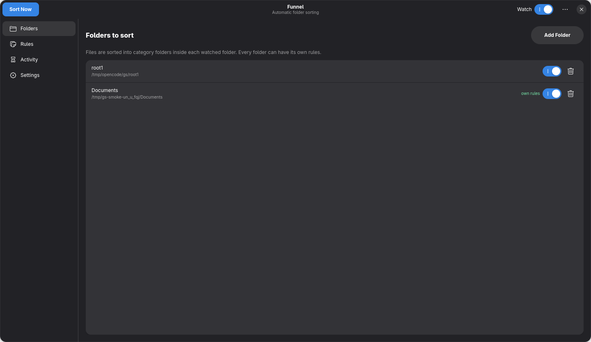
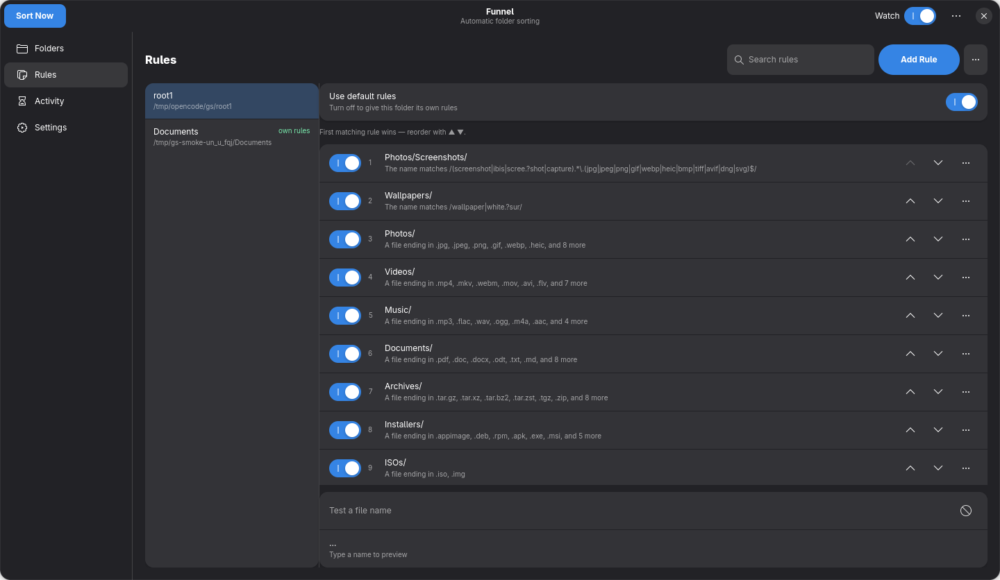
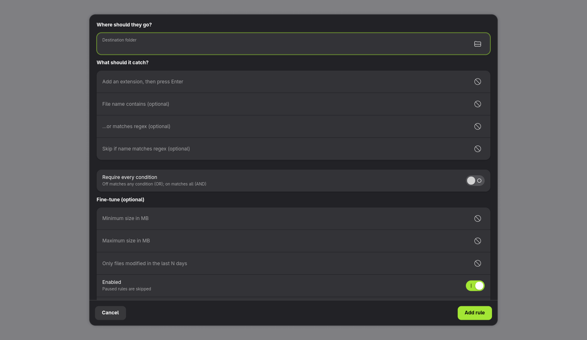
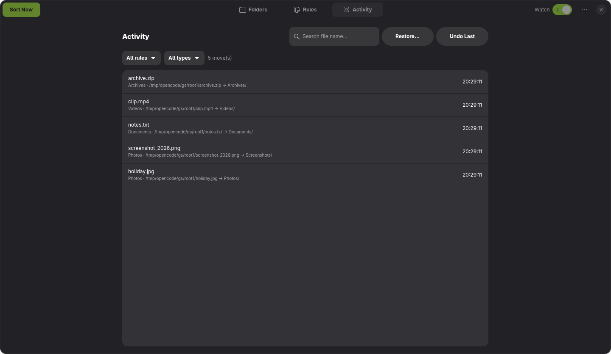
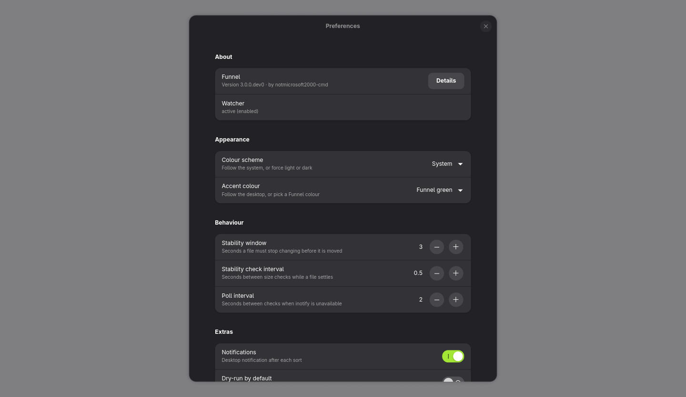
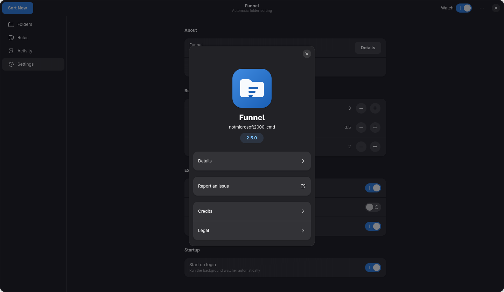

<p align="center"></p>
<h1 align="center">Funnel v2.0</h1>
<p align="center">Automatically sort any folder(s) with per-folder custom rules. GTK4 + libadwaita for Linux.</p>

## Highlights

- **Per-folder rules** — keep different sorting rules for Downloads, Projects, Archives, etc.
- **Split-view editor** — see folders on the left, their rules on the right.
- **Step-by-step wizard + Advanced editor** — simple guided flow or compact power-user form.
- **Quick presets** — GNOME defaults · Photography · Code projects · Empty.
- **KDE/Dolphin service menu** — right-click "Sort with Funnel" in Dolphin.
- **Safe & reversible** — skips in-progress files, stability window, collision-safe, journaled `--undo`.
- **CLI + background watcher** — `--sweep`, `--watch`, per-folder rules via `--root`.
- **User-local install** — `./install.sh` (no sudo). `./uninstall.sh` (optionally `--purge`).
- **Polished UI & About** — clean icon, About dialog with credits and links.

## Screenshots

| Folders | Rules (split view) | Advanced editor | Activity |
|---|---|---|---|
|  |  |  |  |

| Settings | About |
|---|---|
|  |  |

See more: [Website](https://notmicrosoft2000-cmd.github.io/gnu-sorter/) · [Documentation](https://notmicrosoft2000-cmd.github.io/gnu-sorter/docs.html)

## Installation (user-local)

**One line** (downloads the installer script, clones the repo, and runs `install.sh`):

```bash
curl -fsSL https://raw.githubusercontent.com/notmicrosoft2000-cmd/gnu-sorter/main/install-gnu-sorter.sh | bash
```

Add `--service` to enable background watching on login:

```bash
curl -fsSL https://raw.githubusercontent.com/notmicrosoft2000-cmd/gnu-sorter/main/install-gnu-sorter.sh | bash -s -- --service
```

## Updating

The app updates itself from GitHub Releases:

```bash
gnu-sorter --update-check   # what's available?
gnu-sorter --update         # download + install the newest release
```

- The **GUI** checks for updates a few seconds after launch and installs them
  automatically; there is also a *Check for updates…* item in the window menu.
- If the watcher service is running, `gnu-sorter --update` prints the
  `systemctl --user restart gnu-sorter` command to apply it.

Or install by hand:

1. **Clone**: `git clone https://github.com/notmicrosoft2000-cmd/gnu-sorter.git && cd gnu-sorter`
2. **Install**: `./install.sh` (add `--service` to enable background watch on login)
3. **Run**: `gnu-sorter --gui` (or launch from your applications menu)

**Uninstall**: `./uninstall.sh` — config and history kept by default. Use `./uninstall.sh --purge` to remove `~/.config/gnu-sorter/` and `~/.local/share/gnu-sorter/history.log`.

## Quick start

### GUI
1. **Add folders** — Folders → Add Folder
2. **Add a rule** — Rules → Add Rule (wizard: extension/name → destination → review)
3. **Go advanced** — Rules ⋯ → Advanced rule editor… (multi-extension, name/regex)
4. **Presets** — Rules ⋯ → Apply preset
5. **Sort/Watch** — “Sort Now” in header, toggle “Watch” for auto-sort

### CLI
```bash
# Default template rules
gnu-sorter --list-rules

# Add rule to a specific folder only (auto-detaches if inheriting)
gnu-sorter --add-rule quant --folder quant --root ~/Downloads

# View folder's effective rules
gnu-sorter --list-rules --root ~/Downloads

# Revert folder to shared template
gnu-sorter --attach-rules --root ~/Downloads

# Sweep once / watch / undo last
gnu-sorter --sweep
gnu-sorter --watch
gnu-sorter --undo-last 1
```

## About

- Creator: **notmicrosoft2000-cmd**
- Version: **2.0.0**
- Website: https://notmicrosoft2000-cmd.github.io/gnu-sorter/
- Repository: https://github.com/notmicrosoft2000-cmd/gnu-sorter
- Issues: https://github.com/notmicrosoft2000-cmd/gnu-sorter/issues
- License: **GPL-3.0**

A native Windows version is available at
https://github.com/notmicrosoft2000-cmd/gnu-sorter-windows (WinUI 3, GPL-3.0).

